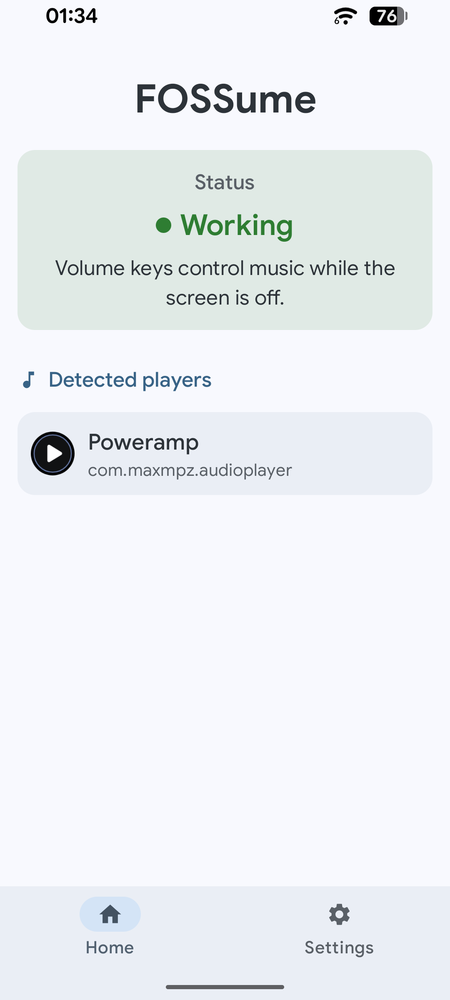
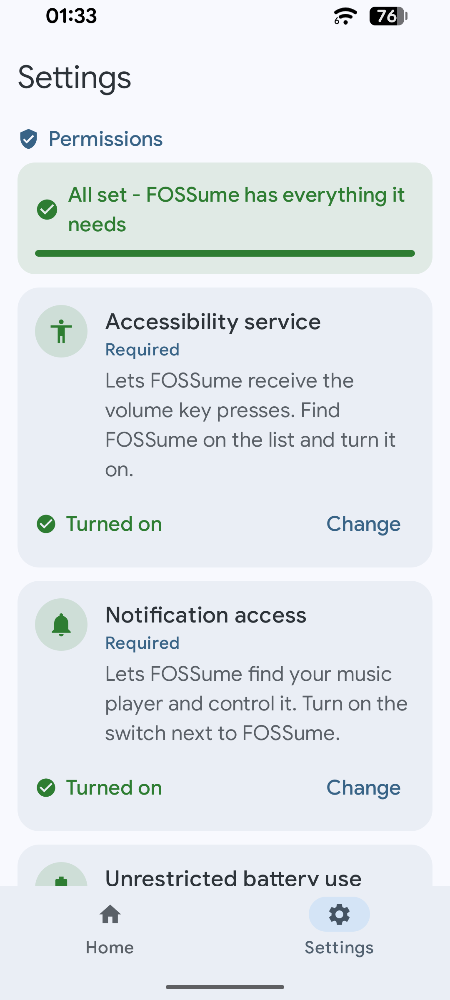
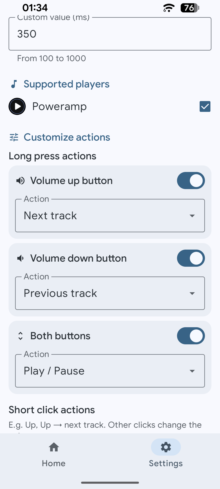
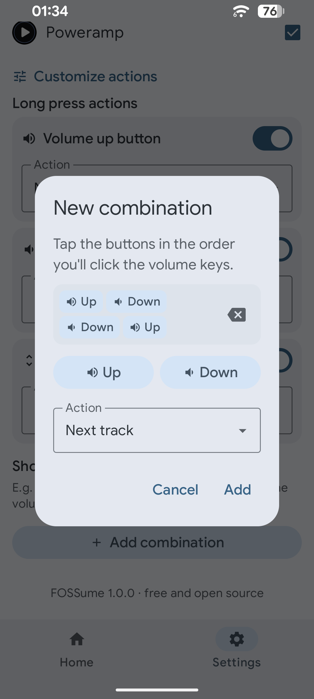

<p align="center">
  
</p>

# FOSSume

Free and open source app for skipping tracks with the volume keys - also with the screen off.
Hold volume up for the next track, volume down for the previous one, or set up your own long
presses and click combinations. Works with any music app, with no account and nothing sent anywhere.

<p align="center">
  
  
  
  
</p>

## Features

**Long presses**
- Volume up, volume down, or both buttons held together
- Each one runs an action of your choice: next or previous track, fast forward or rewind by any
  number of seconds, play/pause, add to or remove from favorites, hide in playlist (Spotify)

**Click combinations**
- Quick presses in a row, e.g. Up, Up → next track, up to 6 presses long, added and removed freely
- Clicks that don't make up a combination change the volume as usual

**Players**
- Works with any player that has a media session: Spotify, YouTube Music, VLC, Poweramp, …
- Controls the player that's playing, or else the one used most recently
- The home screen shows the players seen since the app started and which one is playing; Settings
  keeps a list of every player seen so far, where any of them can be left alone

**The app**
- Only with the screen off or locked, or always - your choice
- Works with Always On Display and with the screen completely off. With the screen fully off
  Android gives the volume keys to no app, only to the media volume, so FOSSume stands in as the
  media volume control while the screen is off (a switch in Settings turns this off)
- Adjustable long press time, gap between clicks and vibration strength
- Volume keys go back to normal during calls
- Material 3 interface with Material You colors and a light/dark theme
- Checks GitHub for a new release on request (a button in Settings), or once a day if you turn
  that on
- English and Polish

## Requirements

- Android 8.0 (API 26) or newer

## Installing

Download `FOSSume-x.y.z.apk` from the [latest release](https://github.com/dearminder/FOSSume/releases/latest)
and open it on the phone. Android may ask you to allow installing apps from your browser or file
manager.

FOSSume needs two permissions, and Settings walks you through both:
- **Accessibility service**, to receive the volume key presses before the system does
- **Notification access**, to find the music player and control it

Unrestricted battery use is recommended, so the system doesn't put FOSSume to sleep with the screen off.

Holding both volume keys for a few seconds is also Android's own accessibility shortcut (Live
Caption, TalkBack, …). Android handles it before any app gets the keys, so if such a feature
turns on by itself, remove it from the volume key shortcut in the system's accessibility settings.

On Android 13 and newer, apps installed outside an app store get the switches for these
permissions greyed out at first. Open App info, tap ⋮ in the corner, choose
**Allow restricted settings** and try again.

## How it works

| Piece | Why |
| --- | --- |
| `VolumeKeyService` (accessibility service) | Gets the volume keys before the system (`flagRequestFilterKeyEvents`) |
| `KeyGestures` | Turns presses into long presses / combinations |
| `MediaNotificationListener` (notification access) | Required to see other apps' media sessions; also detects players |
| `ScreenOffSession` | With the screen fully off, receives the keys as an invisible media session's volume control |
| `MediaControl` | Runs the action on the current player through `MediaController` |
| `Updates.kt`, `UpdateRules.kt` | The update check against GitHub's latest release, and installing it |
| `Settings.kt` | The settings and the saved players, shared by the UI and the services |
| `MainActivity.kt` | The Compose UI: home screen and settings |

Like / unlike / hide use the player's own buttons (session custom actions or notification
buttons), so how well they work depends on the player.

## Privacy

FOSSume's only network access is the update check: one request to GitHub's API for the latest
release, made when you tap "Check now" or, if you turn on the automatic check, at most once
a day when you open the app. It's off by default and nothing about you or your device is sent.
Tapping "Install" downloads the new APK from GitHub into FOSSume's cache, hands it to
the system installer (which asks you to confirm) and deletes the file right away; once installed,
FOSSume opens again. FOSSume only listens to the volume keys - it doesn't read the
screen or anything you type - and it reads media notifications only to find players and their
buttons.

## Building

Open the project in Android Studio (or AndroidIDE), or build from the command line:

```
./gradlew assembleDebug
```

The app uses only AndroidX Core, Activity and Jetpack Compose (Material 3).

## Tests

The gestures, the settings format and the player rules have no Android dependencies, so their unit
tests run on a plain JVM:

```
./gradlew testDebugUnitTest
```

They also run for every push and pull request (`.github/workflows/tests.yml`).

## Releases

`.github/workflows/release.yml` builds a signed APK and publishes it as a release. On GitHub a
release is made for every version tag (`1.0.1`, `1.0.2`, …). On Forgejo every push to `main` is
released as the next version (the last tag + 1), which is also tagged. The signing secrets are
listed at the top of the workflow. On GitHub the workflow also needs Settings > Actions > General >
Workflow permissions set to "Read and write permissions", so it can create the release.

## License

[GNU General Public License v3.0](LICENSE.txt)
